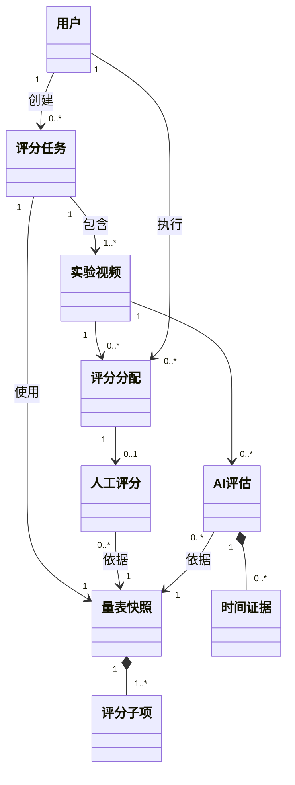

# InnoJudge 功能需求规范

本文对应 FURPS 中的 F（功能性），描述首期离线视频评测功能；URPS 见[非功能需求规范](nonfunctional_spec.md)。功能均为规划，详细规则与待确认事项见[产品需求](product_requirements.md)。

## 1. 系统角色

| 角色 | 职责 |
| --- | --- |
| 教师 | 创建任务、配置量表、上传视频、分配评分、查看人机结果 |
| 评分员 | 查看分配任务，观看视频并独立逐项评分，不查看 AI 结果 |
| 管理员 | 管理账号与角色；具体权限范围待确认 |
| 校领导 | 按授权查看结果与汇总信息；看板指标待确认 |

## 2. 功能分解（F）

| 模块 | 编号 | 功能与验收标准 |
| --- | --- | --- |
| 账号与权限 | FR-1.1 | 支持登录并进入对应角色入口；未登录或越权请求被拒绝 |
| 账号与权限 | FR-1.2 | 管理员可创建、停用账号并分配角色；停用账号不能再登录，账号开通与邀请机制待确认 |
| 任务管理 | FR-2.1 | 教师按基本信息、量表、视频、评分员四步创建任务；必填信息缺失时提示并阻断提交 |
| 任务管理 | FR-2.2 | 教师将指定视频分配给评分员；评分员只能访问分配给自己的对象 |
| 量表管理 | FR-3.1 | 支持上传或选择已有量表，编辑评分项、子项、分值及评分说明 |
| 量表管理 | FR-3.2 | 校验分值非负及分项合计；任务保存量表快照，量表库修改不影响已完成任务 |
| 视频管理 | FR-4.1 | 支持手动上传视频并关联任务与被评对象；显示上传状态及失败原因 |
| 视频管理 | FR-4.2 | 有权用户可播放、暂停及拖动视频；视频文件不可匿名访问 |
| 人工评分 | FR-5.1 | 评分员按量表逐项给分、保存草稿并提交；得分不得小于 0 或超过子项满分 |
| 人工评分 | FR-5.2 | 提交记录评分员、量表版本与时间；评分员页面及接口不含 AI 结果 |
| AI 评估 | FR-6.1 | 对已上传视频离线评估，输出阶段划分、错误操作标注及分项评分报告 |
| AI 评估 | FR-6.2 | 显示排队、运行、成功及失败状态，支持重跑；重跑不覆盖人工评分 |
| 结果查看 | FR-7.1 | 教师按权限查看人工分与 AI 分，分别标注来源，不自动合并为最终成绩 |
| 结果查看 | FR-7.2 | 教师点击评分点或时间标注可跳转对应片段；缺少证据时提示无对应片段 |
| 操作审计 | FR-8.1 | 记录账号变更、任务分配、评分提交与评估重跑的操作者、时间及对象 |

## 3. 核心流程

教师创建任务 → 确定量表 → 上传视频 → 分配评分员；评分员独立评分，AI 并行评估；教师查看人机结果并定位证据。

## 4. 领域模型

模型描述已创建的有效任务；人工评分与 AI 评估分别记录，不相互覆盖。

## 5. 范围边界

实时视频流、身份识别和现场硬件不纳入首期。多人评分汇总、提交后修改、视频规格、AI 字段及数据留存规则待确认，不预设最终成绩公式。
